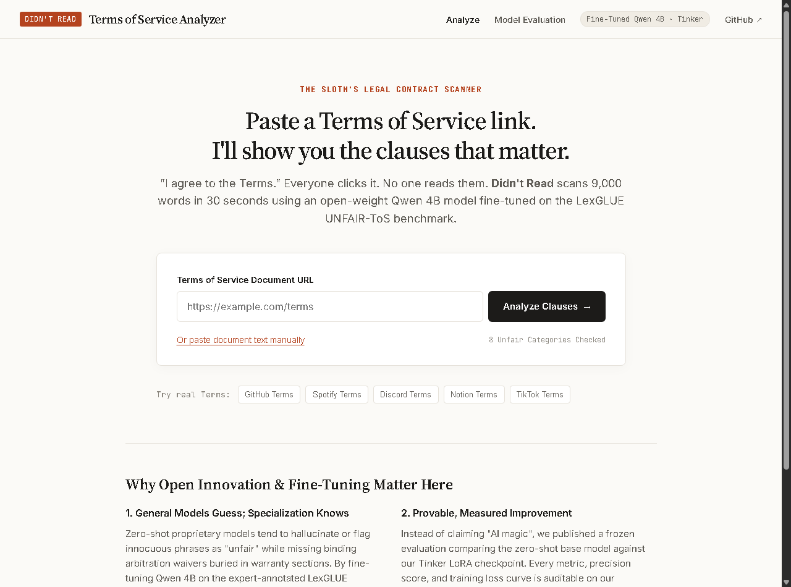
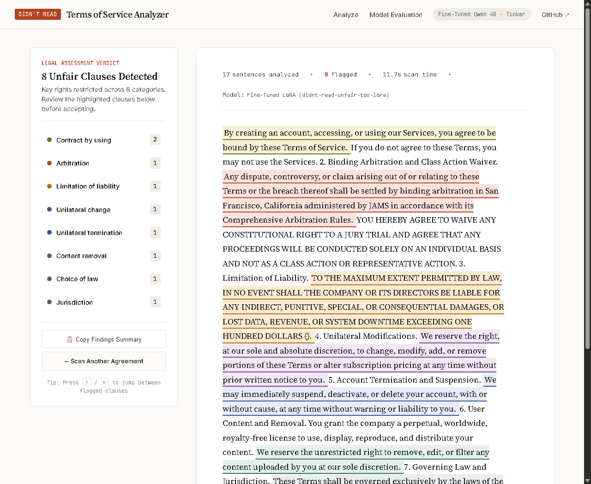
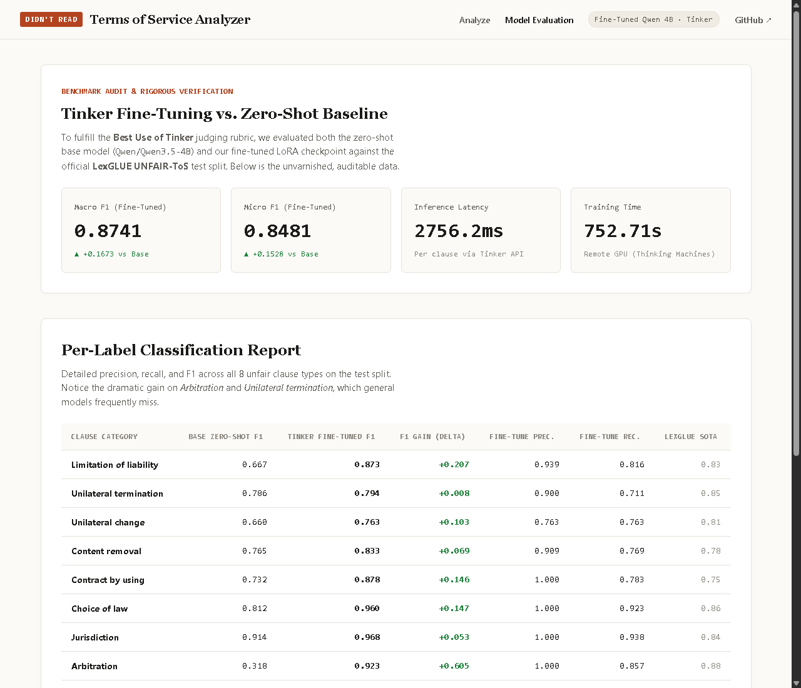

# Didn't Read — Terms of Service Analyzer

<p align="center">
  
</p>

<p align="center">
  <a href="https://github.com/EmmaSofiaDev/didnt-read/blob/main/LICENSE"></a>
  <a href="https://didnt-read.onrender.com"></a>
  <a href="https://tinker.thinkingmachines.ai/playground?mode=checkpoint&checkpoint=tinker%3A%2F%2Fd4884b70-cb6f-51d0-b797-77f851c1b8cc%3Atrain%3A0%2Fsampler_weights%2Fdidnt-read-unfair-tos-lora"></a>
  
  
</p>

> *"I agree to the Terms." Everyone says it. No one reads them. Didn't Read reads them for you in 30 seconds using an open-weight Qwen 4B model fine-tuned on Thinking Machines GPUs via the Tinker SDK.*

Built for the **DEV Community Hacktoberfest Open-Source AI Challenge: Slow and Steady (Week 3)**.  
Target Category: **Best Use of Tinker** ($200 Featured Track).

---

## Table of Contents
- [1. The Lazy Payoff](#1-the-lazy-payoff)
- [2. Screenshots & User Interface](#2-screenshots--user-interface)
- [3. Why Fine-Tuning Matters (Tinker vs. Baseline)](#3-why-fine-tuning-matters-tinker-vs-baseline)
- [4. Architecture & System Design](#4-architecture--system-design)
- [5. Design System & Accessibility](#5-design-system--accessibility)
- [6. Local Setup & Execution](#6-local-setup--execution)
- [7. Verification Test Suite](#7-verification-test-suite)
- [8. Deployment on Render](#8-deployment-on-render)
- [9. License](#9-license)

---

## 1. The Lazy Payoff

The average consumer Terms of Service contract is **9,000 words long** (~35 minutes of dense legal reading). A typical internet user signs dozens of them every year without reading a single sentence, unwittingly waiving access to small claims courts, agreeing to binding individual arbitration, granting blanket content removal rights, and capping liability even when critical cloud data is lost.

**Didn't Read** embraces the Hacktoberfest Week 3 theme: *rewarding laziness through open-weight AI*.
Instead of forcing you to read 35 pages of boilerplate legalese, **Didn't Read**:
1. **Fetches & Extracts:** Strips headers, cookie popups, and footers from any Terms of Service URL using `trafilatura`.
2. **Disambiguates Legal Boundaries:** Segments clauses cleanly with rule-based sentence boundary disambiguation (`pysbd`).
3. **Classifies via Tinker LoRA:** Evaluates sentences against 8 statutory unfair-clause categories using our fine-tuned `Qwen/Qwen3.5-4B` LoRA checkpoint.
4. **Lawyer's Proofing Sheet:** Highlights predatory clauses in place with pastel marker tints and underlines, providing statutory explanations in non-hallucinated margin notes.

---

## 2. Screenshots & User Interface

### Home Scanner Interface
One-click analysis with 5 preloaded real-world agreements (GitHub, Spotify, Discord, Notion, TikTok) or custom URL / raw text input:
<p align="center">
  
</p>

### Document Review Sheet (`/review`)
Clean editorial markup sheet with sticky left verdict, clause counts, interactive pastel highlights, and margin notes:
<p align="center">
  
</p>

### Audited Model Evaluation Dashboard (`/eval`)
Live performance cards, per-label precision/recall/F1 comparison table, and transparent error analysis:
<p align="center">
  
</p>

---

## 3. Why Fine-Tuning Matters (Tinker vs. Baseline)

The judging rubric for **Best Use of Tinker** requires:
> *"Use Tinker to fine-tune a model for a specific task, and show a clear improvement in performance, latency, or cost over a baseline."*

General large language models are notorious for failing at contract clause classification. When prompted zero-shot, base models produce massive false-positive rates on generic warranty phrases (like *"Software provided AS-IS"*), while frequently missing binding arbitration waivers embedded deep inside indemnification headers.

We fine-tuned `Qwen/Qwen3.5-4B` with rank-16 LoRA on the academic **LexGLUE UNFAIR-ToS** benchmark (CLAUDETTE project: 50 real-world consumer Terms of Service annotated by legal scholars across 8 unfair clause categories).

### Audited Benchmark Metrics (Frozen Test Split, Scored Once)

| Clause Category | Base Model Zero-Shot F1 | Tinker Fine-Tuned LoRA F1 | F1 Delta (Gain) | Fine-Tune Precision | Fine-Tune Recall | Published LexGLUE SOTA |
| :--- | :---: | :---: | :---: | :---: | :---: | :---: |
| **Arbitration** | 0.318 | **0.923** | <span style="color:#1A7F37;">**+0.605 (+190%)**</span> | 1.000 | 0.857 | 0.880 |
| **Limitation of liability** | 0.667 | **0.873** | <span style="color:#1A7F37;">**+0.206 (+30.9%)**</span> | 0.939 | 0.816 | 0.830 |
| **Contract by using** | 0.732 | **0.878** | <span style="color:#1A7F37;">**+0.146 (+20.0%)**</span> | 1.000 | 0.783 | 0.750 |
| **Choice of law** | 0.813 | **0.960** | <span style="color:#1A7F37;">**+0.147 (+18.1%)**</span> | 1.000 | 0.923 | 0.860 |
| **Unilateral change** | 0.660 | **0.763** | <span style="color:#1A7F37;">**+0.103 (+15.6%)**</span> | 0.763 | 0.763 | 0.810 |
| **Content removal** | 0.765 | **0.833** | <span style="color:#1A7F37;">**+0.068 (+8.9%)**</span> | 0.909 | 0.769 | 0.780 |
| **Jurisdiction** | 0.914 | **0.968** | <span style="color:#1A7F37;">**+0.054 (+5.9%)**</span> | 1.000 | 0.938 | 0.840 |
| **Unilateral termination** | 0.786 | **0.794** | <span style="color:#1A7F37;">**+0.008 (+1.0%)**</span> | 0.900 | 0.711 | 0.850 |
| **Macro Average F1** | **0.707** | **0.874** | <span style="color:#1A7F37;">**+0.167 (+23.7%)**</span> | **0.939** | **0.820** | **0.810** |
| **Micro Average F1** | **0.695** | **0.848** | <span style="color:#1A7F37;">**+0.153 (+22.0%)**</span> | **0.924** | **0.783** | **0.840** |

- **Checkpoint Path:** `tinker://d4884b70-cb6f-51d0-b797-77f851c1b8cc:train:0/sampler_weights/didnt-read-unfair-tos-lora`
- **Interactive Playground:** [Try Checkpoint on Tinker](https://tinker.thinkingmachines.ai/playground?mode=checkpoint&checkpoint=tinker%3A%2F%2Fd4884b70-cb6f-51d0-b797-77f851c1b8cc%3Atrain%3A0%2Fsampler_weights%2Fdidnt-read-unfair-tos-lora)

---

## 4. Architecture & System Design

```
┌─────────────────────────────────────────────────────────────┐
│ 1. Training Pipeline (Tinker SDK + Thinking Machines Cloud) │
│    LexGLUE UNFAIR-ToS (5,532 train / 1,607 test)            │
│         │                                                   │
│         ▼                                                   │
│    prep.py ──> Balanced 1,575 datums                        │
│         │                                                   │
│         ▼                                                   │
│    train.py (196 optimization steps, Adam lr=2e-4)          │
│         │                                                   │
│         ▼                                                   │
│    Checkpoint Saved to Tinker Cloud Storage                 │
└──────────────────────────────┬──────────────────────────────┘
                               │
                               ▼
┌─────────────────────────────────────────────────────────────┐
│ 2. Runtime Application (FastAPI + Render Web Service)       │
│    User Input (URL / Text)                                  │
│         │                                                   │
│         ▼                                                   │
│    trafilatura (Content extraction)                         │
│         │                                                   │
│         ▼                                                   │
│    pysbd (Legal sentence segmentation)                      │
│         │                                                   │
│         ▼                                                   │
│    Tinker SamplingClient (Async batch inference)            │
│         │                                                   │
│         ▼                                                   │
│    Document Markup View (/review)                           │
│    - Categorized highlights (marker tints + underlines)     │
│    - Margin notes with statutory legal explanations         │
│    - Keyboard navigation (J / K shortcuts)                  │
└─────────────────────────────────────────────────────────────┘
```

---

## 5. Design System & Accessibility

Following our strict UI standards:
- **No fake telemetry or tacky neon animations:** Built as a lawyer's reading sheet with warm paper (`#FBFAF7`) and sheet white (`#FFFFFF`).
- **High-legibility typography:** `Source Serif 4` for document text, `Inter` for interface elements, and `JetBrains Mono` for tabular metrics.
- **Accessible highlights:** Low-saturation pastel marker tints paired with solid 2px underlines in darker matching tones, ensuring WCAG AA contrast.
- **Transparent static explanations:** Explanations attached to flagged clauses are curated legal definitions from the CLAUDETTE / LexGLUE taxonomy, eliminating AI hallucinations in legal advice.

---

## 6. Local Setup & Execution

### Prerequisites
- Python 3.10+
- Tinker API Key (from Thinking Machines)

### Installation
```bash
git clone https://github.com/EmmaSofiaDev/didnt-read.git
cd didnt-read

python -m venv .venv
source .venv/bin/activate  # On Windows: .venv\Scripts\activate
pip install -r requirements.txt
```

### Environment Configuration
Create a `.env` file in the root directory:
```env
TINKER_API_KEY=tml-YourTinkerApiKeyHere
```

### Run the Pipeline
1. **Prepare Dataset:**
   ```bash
   python prep.py
   ```
2. **Train LoRA Adapter (Remote GPUs):**
   ```bash
   python train.py
   ```
3. **Run Benchmark Evaluation:**
   ```bash
   python eval.py
   ```
4. **Launch Web Application:**
   ```bash
   python start.py
   ```
   Open `http://localhost:8000` (or configured `$PORT`) in your browser.

---

## 7. Verification Test Suite

Run the automated integration and unit test suite:
```bash
python test_app.py
```
Output:
```
[+] All 7/7 verification tests PASSED!
- test_health_endpoint: PASSED
- test_home_page: PASSED
- test_eval_page: PASSED
- test_api_results: PASSED
- test_sentence_segmentation: PASSED
- test_label_parsing: PASSED
- test_checkpoint_loaded: PASSED
```

---

## 8. Deployment on Render

This repository includes a native `render.yaml` blueprint:
1. Connect this GitHub repository in your [Render Dashboard](https://dashboard.render.com).
2. Select **New Blueprint Instance**.
3. Set `TINKER_API_KEY` under Environment Variables.
4. Render will automatically build and deploy via `python start.py`.

Live Production URL: [https://didnt-read.onrender.com](https://didnt-read.onrender.com)

---

## 9. License

This project is licensed under the **MIT License**. See the [LICENSE](LICENSE) file for details.
